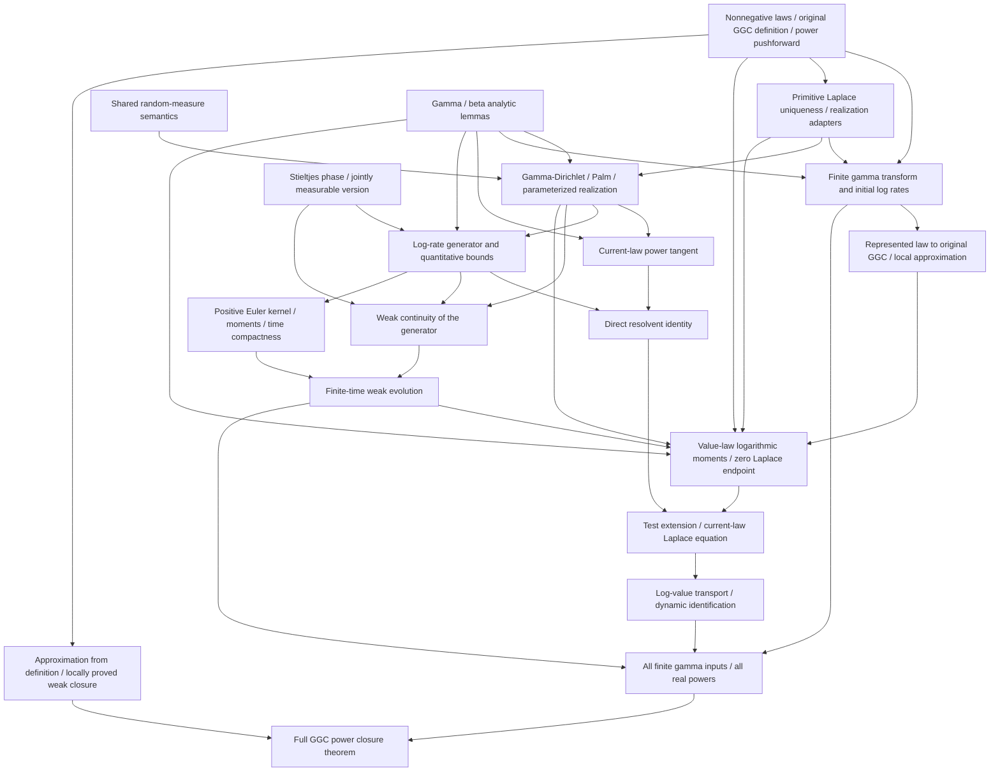

# Lean Blueprint for GGC Power Closure

Maintainer: **designer**. This is the current mathematical/technical construction
specification, read-only for the constructor. Roles, permissions, handoffs,
evidence states and report maintenance are specified only in
[README](README.md#roles-and-permissions).

Current design-acceptance conclusions live in [AcceptanceReport](AcceptanceReport.md);
independent judgments and recheck coverage live in [AuditReport](AuditReport.md).
Neither a contract below nor a successful build constitutes an acceptance or
audit decision. `verified` has the [README meaning](README.md#evidence-states).

The trust boundary is standard logic plus E-S1. Other retained literature
interfaces have local proofs; unused general J1, the Thorin converse/equivalence,
E-B2/E-B4 and RV-1 remain outside current delivery scope. Old staged designs,
acceptance narratives and superseded baselines remain in Git at
`4ddc3967c568ee99268f72ae8d443da7641d0fe1`; this file retains effective contracts.

## 1. Final theorem and required scope

For a real-valued probability law \(\mu\) concentrated on \([0,\infty)\), and \(q\in\mathbb R\) with \(1\le q\), prove

\[
\operatorname{IsGGC}(\mu)
\quad\Longrightarrow\quad
\operatorname{IsGGC}\bigl((x\mapsto x^q)_*\mu\bigr).
\]

The declaration `GGC.GGCPowerClosure : Prop` in [Definitions.lean](Definitions.lean) has this quantifier structure and unfolds the original weak-limit definition below. Its proof is `GGC.ggc_rpow` in [main.lean](main.lean). The substantive hypotheses are only nonnegativity of the probability law, GGC membership, and \(q\ge1\); the registered literature dependencies remain explicit in the audit. Its scope includes:

- Every finite real exponent, including noninteger powers and \(q=1\), rather than only squares or a local interval of exponents.
- Arbitrary drift \(a\ge0\), infinite total Thorin mass, and nonatomic Thorin measures.
- All nonnegative degenerate laws, including \(\delta_0\) and \(\delta_a\). Random-variable values are finite real numbers; \(+\infty\) is not an additional value.
- No final assumptions of finite moments, finite logarithmic moments, finite Thorin mass, finite support, or zero drift.

First prove power closure for finite gamma convolutions. Then, for each fixed \(q\), use weak approximation and GGC weak closure. The second log-rate moments and construction constants may depend on each finite input and on \(T=\log q\). They need not be uniform over the approximating sequence. An evolution on an infinite time interval is not required.

## 2. Objects and interface conventions

Use a **law-first, supported-real** model. The implemented `GGC.NonnegLaw` in [Definitions.lean](Definitions.lean) wraps `MeasureTheory.ProbabilityMeasure ℝ` together with an a.e. nonnegativity proof for its underlying measure. That file owns all project-specific definitions required to read the main statement. The distribution theorem is the complete required result; no random-variable corollary is required. Choosing a common probability space, independent copies, or a path process must not become additional main-theorem hypotheses.

| Object | Representation and contract |
|---|---|
| Nonnegative value law \(\mu\) | `NonnegLaw` and `powerLaw μ q hq` are implemented in `Definitions.lean`, where `hq : 0 ≤ q`. The definition uses the actual map \(x\mapsto x^q\), its continuity for nonnegative exponents, and a proof of nonnegative concentration. `powerLaw_toMeasure` exposes this semantics; `powerLaw_one` and `isGGC_powerLaw_one` supply the exponent-one sanity check. `GGC/Basic.lean` now proves fixed-power preservation of weak convergence as `power_pushforward_tendsto`. |
| Positive rate \(b\) | `PosReal := {b : ℝ // 0 < b}` is implemented in `Definitions.lean`. Rate space and value space are distinct. Log rates live in \(\mathbb R\); `RateRealization` supplies the measurable `exp`/`log` equivalence and pushforward adapters. |
| Thorin data | `ThorinAdmissible` and `ThorinData` live in `GGC/Thorin/Basic.lean`, re-exported by `GGC/Thorin.lean`. They contain nonnegative drift \(a\), a positive rate measure \(U\), and `Integrable` for \(\log(1+1/b)\), without finite total mass. `ThorinAdmissible.integrable_log` proves integrability for every \(s\ge0\); `thorinAdmissible_iff_endpoint` proves the endpoint equivalence, explicitly including local finiteness. These data describe the analytic characterization, not the original GGC definition. |
| GGC membership | Implemented: `IsGGC μ` means that \(\mu\) is a weak limit of actual finite gamma convolutions, as specified in Section 2.1. It has no Thorin-representation premise. |
| Thorin representability | `HasThorinRepresentation` remains separate from `IsGGC`. `HasThorinRepresentation.isGGC` proves the direction required by the main theorem, using locally proved E-B3. The unused converse and equivalence were retired with E-B2. `existsUnique_law_thorinLaplace` combines the locally proved E-B1 with local Laplace uniqueness, using standard logic only. |
| Finite gamma law | `gammaLaw`, `finiteGammaLaw`, and `IsFiniteGammaConvolution` use actual gamma measures and a finite product/sum pushforward in `Definitions.lean`. `ProbabilityMeasure.pi` has underlying measure `Measure.pi`. No transform formula defines this class. `laplace_finiteGammaLaw` proves its exponential finite-sum transform for every \(s\ge0\); `finiteThorinMeasure`, `finiteThorinData` and `hasThorinRepresentation_finiteGammaLaw` supply the adapter \(U=\sum_i\alpha_i\delta_{b_i}\). The empty product/sum gives \(\delta_0\). `Identification.exists_finiteGamma_initialData` supplies normalized log-rate data and the nonempty mass/second-moment certificates. |
| Log-rate state \(F\) | `ProbabilityMeasure ℝ`, with an additional finite-second-moment hypothesis where needed. Set \(U=B\exp_*F\). Define coefficients for every probability \(F\), before proving Thorin admissibility, so the Euler iteration is not circular. |
| Evolution \(F_t\) | `LogRate.WeakLogRateSolution` packages a narrowly continuous probability curve, its initial state, a uniform second-moment bound and the integral weak equation for the specified generator on \([0,T]\). `LogRate.exists_weakLogRateSolution` constructs an inhabitant from the actual Euler curves for every \(T>0\); it does not assume an existence axiom. |
| Value and log-value laws | \(\mu_t\) is the zero-drift GGC law associated with \(U_t\); \(\lambda_t=(\log)_*\mu_t\). Prove \(\mu_t((0,\infty))=1\) before taking log values. \(F_t\) describes log **rates**, whereas \(\lambda_t\) describes log **values**. |
| Test functions | Specify predicates or structures for \(C_c^2(\mathbb R)\), linearly growing \(C^2\) functions with bounded first and second derivatives, and \(C_c^1((0,\infty))\). Moving between test domains requires an extension lemma. |

Use the pinned source and the [shared API index](MathlibAPI.md) for actual imports and applications. Recheck APIs when contracts or dependencies change; search failure does not authorize narrowing these contracts.

### 2.1 Original definition and the represented-law adapter

For \(k\in\mathbb N\) and shapes/rates \(\alpha_i,b_i>0\), define the finite gamma law by
\[
\operatorname{finiteGammaLaw}(k,\alpha,b)
 =\left(x\mapsto\sum_{i\in\mathrm{Fin}(k)}x_i\right)_*
   \bigotimes_{i\in\mathrm{Fin}(k)}\operatorname{Gamma}(\alpha_i,b_i).
\]
The product measure encodes independence. A law is `IsFiniteGammaConvolution` exactly when it equals such a pushforward. Shapes and rates may vary with every approximant, \(k=0\) is permitted, and no boundedness or uniform moment condition is added. The actual gamma law uses the shape/rate density already represented by mathlib's `ProbabilityTheory.gammaMeasure`; give the complete project wrappers in `Definitions.lean` and prove their normalization and nonnegative concentration.

The public definition is
\[
\operatorname{IsGGC}(\mu)\;:\!\Longleftrightarrow\;
\exists(\mu_n)_{n\in\mathbb N},\quad
 (\forall n,\ \operatorname{IsFiniteGammaConvolution}(\mu_n))
 \ \land\ \mu_n\Rightarrow\mu.
\]
Use a sequence of `NonnegLaw` objects and `Tendsto` of their underlying `ProbabilityMeasure ℝ` values to `μ.law` in the weak topology. This statement does not quantify over a shared sample space or over Thorin data. If topology-based closure is used internally, prove its equivalence with this sequential definition. In particular, prove weak closure of this class locally by the sequential/closure bridge or a metric diagonal argument; it does not follow merely by unfolding one existential sequence.

Keep the analytic predicate separate:
\[
\operatorname{HasThorinRepresentation}(\mu)\;:\!\Longleftrightarrow\;
\exists a\ge0,\ U\ge0,\quad
 \int\log(1+1/b)\,U(db)<\infty,
\quad\forall s>0,\quad
 L_\mu(s)=\exp\{-as-\int\log(1+s/b)\,U(db)\}.
\]
`GGC/Thorin.lean` exposes `HasThorinRepresentation.isGGC` for every
`NonnegLaw`. This locally proved direction covers zero and constant laws,
nonzero drift, nonatomic measures and infinite Thorin mass. It is sufficient
to certify the value laws constructed in the power-closure proof. It is never
the definition of `IsGGC` or an extra hypothesis of `ggc_rpow`.

The unused original-GGC-to-Thorin converse, equivalence and E-B2 are retired.
The E-B4 fallback and random-variable corollary RV-1 are withdrawn. They are
not required deliverables or new assumptions of the main theorem. Retiring
these interfaces does not prove them.

Arbitrary admissible Thorin data has a unique realizing law through locally
proved E-B1 and Laplace uniqueness. E-B3 supplies actual finite-gamma
approximation and the represented-law membership direction. Positive constant
laws therefore remain locally proved GGC members. Admissibility includes local
finiteness through a proved equivalence; no extra mass/moment assumption is
added to `IsGGC`.

**Semantic acceptance:** inspect the full definitions of `gammaLaw`,
`finiteGammaLaw`, `IsFiniteGammaConvolution`, `IsGGC` and
`HasThorinRepresentation`, together with the retained membership direction.
Check actual product-law independence, weak convergence, empty sums, single
Gamma laws and every nonnegative constant. The axiom-free original-GGC weak
closure remains in `GGC.WeakClosure`; it is not the removed E-B2 statement.

Source provenance remains Bondesson (1992), Section 3.1, pp.29 and 34-35,
as recorded in the [primary-interface note](../notes/log-rate-power-proof-primary-interfaces.md).
Historical two-direction characterization records remain in Git; they do not
change the current retained membership direction.

## 3. Main dependency graph

Use the **direct log-generator resolvent verification** of [WIP-6.22](../ledger/24-direct-log-generator-resolvent.md#wip-6-22). This removes a dependency on the intermediate rate-coordinate operator. The general rate operator, conditional mass formula, and local continuation route in WIP-6.12--6.15 are optional extensions, not prerequisites for the first main-theorem implementation.

The graph describes mathematical dependencies; source imports must also remain
acyclic. Locally proved Thorin, Gamma/Dirichlet, Palm and stick-breaking layers
are independent of their upper consumers. SSV imports mathlib only. The finite
input construction uses the represented-law-to-original-GGC direction; the final
weak-limit argument extracts approximants directly from the original definition.

## 4. Module owners and construction order

Paths below are relative to `formalization`. The `GGCPower` library roots/globs
cover `Definitions`, `main`, all `GGC`/`External` descendants and `AxiomAudit`.
`Checks` and `ForHumanCheck` are checked separately.

| Contract / owner | Implemented module and required boundary |
|---|---|
| Complete public definitions | [Definitions.lean](Definitions.lean); mathlib-only, actual measures/product/sum/pushforward, original GGC and full target proposition |
| Elementary laws and weak closure | [GGC/Basic.lean](GGC/Basic.lean), [FiniteGamma](GGC/FiniteGamma.lean), [WeakClosure](GGC/WeakClosure.lean); zero/constant laws, finite gamma transforms, fixed-power convergence, original-GGC closure |
| Primitive Laplace analysis | [GGC/Laplace.lean](GGC/Laplace.lean), [LaplaceContinuity](GGC/LaplaceContinuity.lean), [LaplaceTightness](GGC/LaplaceTightness.lean); uniqueness and probability limits without extra moments |
| Thorin semantics and E-B1/E-B3 | [GGC/Thorin/Basic.lean](GGC/Thorin/Basic.lean), `Approximation`, `GridMeasure`, `GridMeasureMap`, `FiniteWeights`, `Drift`, `Normalization`, `Sequence`, [Realization](GGC/Thorin/Realization.lean), [Interfaces](GGC/Thorin/Interfaces.lean); lower proofs import no External or upper identification/power consumer |
| Public represented-law facade | [GGC/Thorin.lean](GGC/Thorin.lean); represented-law membership, realization and constant laws; no unused converse/equivalence |
| Shared random-measure semantics | [Foundations/RandomMeasure.lean](GGC/Foundations/RandomMeasure.lean), [Posterior](GGC/Foundations/Posterior.lean), [StickBreaking](GGC/Foundations/StickBreaking.lean); actual probability measures and finite-partition DP semantics |
| Finite Gamma/Dirichlet foundations | [BetaGamma](GGC/Foundations/BetaGamma.lean), [GammaDirichlet](GGC/Foundations/GammaDirichlet.lean), [DirichletUpdate](GGC/Foundations/DirichletUpdate.lean), [MarkovKrein](GGC/Foundations/MarkovKrein.lean), [DirichletSizeBias](GGC/Foundations/DirichletSizeBias.lean); actual joint laws, zero shapes, bounded transform and stationarity |
| Full local posterior/Palm/stick interfaces | [DirichletPosterior](GGC/DirichletPosterior.lean), [DirichletPalm](GGC/DirichletPalm.lean), [DirichletStickBreaking](GGC/DirichletStickBreaking.lean), with independent lower proofs; arbitrary measurable-space public contracts |
| Gamma/Beta and parameterized realizations | `GammaAnalysis`, `BetaAnalysis`, `GammaDirichlet`, `GammaDirichletTangent`, `Palm`, `RateRealization`, `DirichletRealization`, `CommonUniforms` and ordered quantile foundations |
| Canonical phase and actual power tangent | [StieltjesPhase](GGC/StieltjesPhase.lean), [PowerTangent](GGC/PowerTangent.lean); local measurable versions/boundary recovery, actual differentiated power transform |
| Specified generator / resolvent | `GGC/LogRate/Generator`, `CanonicalGenerator`, `CanonicalBounds`, `DriftBounds`, `Kernel`, `JumpMeasure`, `JumpCalculus`, `GeneratorResolvent`, `SampleResolvent`, `PosteriorResolvent` |
| Generator continuity | `PhaseWeakContinuity`, `PhaseScalingContinuity`, `DirichletContinuity`, `PosteriorDomination`, `LogRate/SampleContinuity`, `GeneratorContinuity`, `Continuity` |
| Positive evolution | `LogRate/Euler`, `EulerIteration`, `EulerInterpolation`, `EulerConsistency`, `EulerLimitCurve`, `EulerWeakEquation`, [Existence](GGC/LogRate/Existence.lean); constructed finite-horizon solution |
| Dynamic identification | `Identification/Moments`, `ValueTails`, `LaplaceEndpoint`, `TangentSpaceTime`, `TestExtension`, `LaplaceEvolution`, `LogTransport`, `TransportUniqueness`, [DynamicIdentification](GGC/Identification/DynamicIdentification.lean) |
| Finite and general powers | [PowerClosure](GGC/PowerClosure.lean) owns finite-input helpers; [main](main.lean) owns the unique `GGC.ggc_rpow`; [Reduction](GGC/Reduction.lean) supplies a separately named conditional reduction |
| Retained assumption and audit | [External/SSV.lean](External/SSV.lean) owns only E-S1; [AxiomAudit](AxiomAudit.lean) inspects full definitions/types, proof body and transitive dependencies |

### 4.1 Definition/proof separation and readable entry point

`Definitions.lean` owns `PosReal`, `NonnegLaw`, `gammaLaw`, `finiteGammaLaw`,
`IsFiniteGammaConvolution`, `IsGGC`, `powerLaw` and `GGCPowerClosure`, including
construction proof fields. It imports mathlib only. Helpers import Definitions;
none of main's dependencies may import main. Locally proved interfaces belong
to their mathematical owners, not External or old External aliases.

`GGC/PowerClosure.lean` retains detailed finite-input proofs. `main.lean` imports
Definitions, PowerClosure and WeakClosure and visibly carries out four steps:

1. Unpack the original GGC definition into actual finite-gamma approximants,
   without any uniform moment, shape or rate bound.
2. Apply `isGGC_power_of_isFiniteGammaConvolution` to each approximant, covering
   empty sums and q = 1; for q > 1 the helper constructs the evolution to log q
   and identifies the actual power law.
3. Apply `power_pushforward_tendsto` for the continuous fixed power map and
   identify the actual probability limit.
4. Apply `isGGC_of_tendsto`, removing finite-input construction restrictions.

Keep named membership/convergence facts and explanatory English mathematical
comments. Do not move long analysis into main or replace the visible assembly
by an undischarged reduction premise. `AxiomAudit` imports main, checks its
expanded type, prints its proof and examines its actual axiom closure.

### 4.2 Module acceptance gate

Apply the [README reuse workflow](README.md#mathlib-reuse-workflow) before
substantial new/revised modules. The constructor supplies API IDs, full types,
actual compiled uses and exact missing bridges in [MathlibAPI](MathlibAPI.md).
The designer checks:

1. Every generic component has a pinned-source/type comparison and a reason
   for any substantial local definition or foundational proof.
2. Adopted APIs apply to actual project objects with unchanged assumptions;
   production proofs or durable probes supply reproducible use evidence.
3. Adapters preserve probabilities, signs, shape/rate conventions, measurable
   structures, integrability and null sets.
4. The implementation, scoped gaps and actual transitive axioms agree with the
   full contract. Compilation of infrastructure alone does not prove a consumer.

The designer records actual acceptance in AcceptanceReport. Audit methods and
findings remain in AuditReport. Shared check details live in Checks/README;
routine documentation maintenance does not require rebuilding unrelated proofs.

### 4.3 Written-proof mapping

| Mathematical contract | Written source |
|---|---|
| Finite-Thorin tangent, posterior and phase | [WIP-6.11--6.15](../ledger/19-finite-thorin-compensated-power-tangent.md), [power tangent section](../manuscript/sections/02-power-tangent.tex) |
| Log-rate generator, compensation and bounds | [WIP-6.16--6.17](../ledger/20-finite-thorin-positive-steps.md), [generator section](../manuscript/sections/03-log-generator.tex) |
| Continuity and Euler existence | [WIP-6.18--6.19](../ledger/21-log-thorin-euler-evolution.md), [evolution section](../manuscript/sections/04-evolution.tex) |
| Dynamic identification | [WIP-6.20](../ledger/22-power-flow-identification.md#wip-6-20), [identification section](../manuscript/sections/05-identification.tex) |
| Full theorem and direct resolvent check | [WIP-6.21](../ledger/23-power-theorem-assembly-audit.md#wip-6-21), [WIP-6.22](../ledger/24-direct-log-generator-resolvent.md#wip-6-22), [completion section](../manuscript/sections/06-completion.tex) |
| Full-quantifier internal mathematical audit | [WIP-6.23](../ledger/25-mathematical-completion-audit.md#wip-6-23); this is not a second independent theorem |

The actual Lean modules above supersede proposed historical filenames. Source
interfaces are recorded in the [external inventory](External/README.md) and
[primary-interface note](../notes/log-rate-power-proof-primary-interfaces.md).

## 5. Critical mathematical contracts

### Foundational adapters shared by the proof nodes

`GGC/Laplace.lean` now proves `nonnegLaw_eq_of_laplace_eq`: two nonnegative probability laws with the same Laplace transform at every positive parameter are equal, without extra moments. The locally proved E-B1 gives existence; `existsUnique_law_thorinLaplace` combines it with local uniqueness, using standard logic only. Reuse uniqueness to identify realizations with gamma--Dirichlet products and subsequential limits in M6. Choosing one E-B1 witness does not itself prove continuity or measurability as its data vary. Those properties remain outputs of `Identification/Moments.lean`, using the logarithmic tail bounds. For the supported-real model, also justify the passage to probabilities on the positive subtype and continuity of the log pushforward; `Real.log` is not continuous at zero.

`GGC/GammaAnalysis.lean` must use shape/rate gamma conventions and actual beta laws; below \(B>0\) and \(G_B\sim\mathrm{Gamma}(B,1)\) has unit rate. Set \(\psi=\Gamma'/\Gamma\) on positive arguments (or prove equivalence with a reused definition), and supply
\[
\mathbb E[G_B\log G_B]=B\psi(B+1),\qquad
\mathbb E[-\log Z]=\psi(B+1)-\psi(1),\quad Z\sim\mathrm{Beta}(1,B),
\]
with absolute integrability, as well as the gamma negative-log bound \(\mathbb E(\log G_B)^-\le[\Gamma(B)B^2]^{-1}\). Supply continuity and bounds for these constants on compact subsets of \((0,\infty)\). These are local analytic obligations, not extra conclusions supplied by E-J1 or E-J3.

### A. Current-law tangent and measurable phase

The input is any admissible, nonzero, finite Thorin measure \(U\), of mass \(B>0\), with its associated zero-drift value law \(\mu\). For \(P\sim DP(U)\) and \(s>0\), define

\[
M_P(s)=\int\frac{P(db)}{s+b},\qquad
W_P(s)=\int\frac{b\,P(db)}{(s+b)^2},\qquad
g(s)=-\partial_s\log L_\mu(s).
\]

Deliver the actual power derivative
\(h_U(s)=\left.\partial_q[-\partial_s\log L_{\operatorname{powerLaw}(\mu,q)}(s)]\right|_{q=1}\), together with

\[
\frac{h_U(s)+g(s)}B
=\mathbb E\bigl[W_P(s)\{\psi(B+1)+1+\log M_P(s)\}\bigr].
\]

This is differentiability at the **current law**; it does not assume that any positive-time power is GGC. Exponential tilting needs a marginal distribution identity for each \(s\), not a joint coupling assertion about the original tilts.

The tangent module must also deliver the bridge consumed by identification. With
\[
A_U(s)=\frac{\int x\log x\,e^{-sx}\,\mu(dx)}{L_\mu(s)},
\qquad h_U(s)=\partial_s\{sA_U(s)\},
\]
prove the second equality for the actual power derivative defined above, not as a new definition of an unrelated tangent. Establish the required mixed differentiation and domination locally on compact positive \((s,q)\)-intervals around \(q=1\), and positivity of the normalizer. The bounds apply under the tilted integrals and require no un-tilted \(X\log X\) moment.

For the phase, deliver \(0\le\xi_P(t)\le1\), joint Borel measurability in \((P,t)\), the anchor-one formula, and a.e. uniqueness:

\[
\log M_P(s)-\log M_P(1)
=\int_0^\infty\xi_P(t)\left(\frac1{s+t}-\frac1{1+t}\right)dt.
\]

Construct a specific representative using the boundary `limsup` along integers \(n\ge1\). Separate external existence of a bounded phase representation from the project's jointly measurable version. Do not assume convergence at every boundary point or add \(M_P(0)<\infty\).

### B. The specified generator and its resolvent identity

Define \(a_{B,F}\) and \(k_{B,F}\) exactly as in [WIP-6.16--6.17](../ledger/20-finite-thorin-positive-steps.md). The Palm posterior is \(DP(U+\delta_b)\), but the tangent's digamma coefficient remains \(\psi(B+1)\), using the original mass. The generator is

\[
\mathcal G_{B,F}\varphi(y)=a_{B,F}(y)\varphi'(y)
+\int_{\mathbb R}[\varphi(y+v)-\varphi(y)-v\varphi'(y)]
 k_{B,F}(y,v)\,\nu_0(dv),\qquad
\nu_0(dv)=\frac{dv}{4\sinh^2(v/2)}.
\]

The reference measure has no atom at zero. Compensation covers **all** jump sizes. First prove \(K\in L^1\), \(m_2=\int v^2\nu_0(dv)<\infty\), \(0\le k\le1\), and \(|a-y|\le C_I\). For \(B\in I\Subset(0,\infty)\), the constants must be independent of \(F,y\). The main proof needs only finiteness of \(m_2\); its closed form \(2\pi^2/3\) need not add a dependency.

For \(\varphi_s(y)=(s+e^y)^{-1}\), prove

\[
F(\mathcal G_{B,F}\varphi_s)=\frac{h_U(s)+g(s)}B.
\]

The proof sequence is: algebraic cancellation of combined kernels; absolute integrability of each term used; the sample identity; an absolute posterior drift bound; then signed Palm/Fubini. Integrate the three terms defining \(K\) together, rather than splitting divergent integrals and cancelling them afterward. Use [WIP-6.22](../ledger/24-direct-log-generator-resolvent.md#wip-6-22).

### C. Continuity, positive discrete kernels, and existence

The continuity contract is: if \(B_n\to B>0\), \(F_n\Rightarrow F\), and \(y_n\to y\), then for every \(\varphi\in C_c^2\),
\(\mathcal G_{B_n,F_n}\varphi(y_n)\to\mathcal G_{B,F}\varphi(y)\); consequently \(H_\varphi(B,F)=F(\mathcal G_{B,F}\varphi)\) is continuous. Use common uniforms, quantiles, stick-breaking, and weak-star phase convergence against \(L^1\) kernels. Pointwise continuity of boundary phases cannot replace this argument. In stick-breaking, the independent variables are the Beta break fractions \(V_j\) and the locations, not the weights \(W_j=V_j\prod_{i<j}(1-V_i)\).

This interface also supplies, for every compact positive mass interval \(I\), a finite constant \(C_{I,\varphi}\) with
\(\sup_{B\in I,F,y}|\mathcal G_{B,F}\varphi(y)|\le C_{I,\varphi}\).
Derive it from B's drift bound and compact support of \(\varphi'\). Use it with local uniform convergence and tightness to integrate against varying \(F\), and later to pass through the time integral. Joint continuity alone does not supply this bound on the noncompact state space.

For an Euler step, take **\(0<h\le1/16\)**, \(\epsilon=\sqrt h\), and freeze \(B,F\). In the finite-horizon construction choose \(h=T/N\) with \(N\ge1\) large enough to meet this bound, and let \(N\to\infty\). Set

\[
\lambda_\epsilon(y)=\int_{|v|>\epsilon}k(y,v)\nu_0(dv),\quad
m_\epsilon(y)=\int_{|v|>\epsilon}vk(y,v)\nu_0(dv),\quad
a_\epsilon=a-m_\epsilon,\quad p=1-h\lambda_\epsilon.
\]

The actual iteration kernel must be

\[
\Pi_h(y,dz)=p(y)\delta_{y+h a_\epsilon(y)/p(y)}(dz)
+h\int_{|v|>\epsilon}\delta_{y+v}(dz)k(y,v)\nu_0(dv).
\]

Prove the uniform truncation bound \(\lambda_\epsilon(y)\le2/(e^\epsilon-1)\le2/\epsilon\), so \(p(y)\ge1-2\sqrt h\ge1/2\). This is a small-step contract, not a claim for arbitrary positive \(h\).

Acceptance requires kernel measurability, \(p\ge1/2\), total mass exactly one, the exact mean \(\mathbb E(\Delta\mid y)=ha(y)\), and the second-moment recursion, for the admissible steps just specified. Prove uniform tightness and time control, and choose a subsequence independently of the test function. The cumulative error must vanish, for example through
\(C[\sqrt h+h(1+|\log h|^2)]\to0\).

The existence output must be precisely: for every \(B_0>0\), probability \(F_0\) with finite second moment, and \(T>0\), there is a narrowly continuous \(F_t\) with the prescribed initial state, a uniform second-moment bound, \(B_t=B_0e^{-t}\), and

\[
F_t(\varphi)-F_0(\varphi)
=\int_0^t F_r(\mathcal G_{B_r,F_r}\varphi)\,dr
\qquad(\varphi\in C_c^2,\ 0\le t\le T).
\]

A positive minimum property, a formal tangent, or positivity of one step does not satisfy this existence contract. Do not replace the construction with an unproved general nonlinear-generator existence axiom.

### D. Endpoint control, dynamic identification, and final assembly

The identification theorem consumes exactly C's output and uses the same \(\mathcal G\). First prove admissibility of \(U_t=B_t\exp_*F_t\), strict positivity and narrow continuity of its value law \(\mu_t\), and

\[
\sup_{t\le T}\int|\log x|\,\mu_t(dx)<\infty.
\]

Extend the weak equation by cutoffs to linearly growing tests with bounded derivatives. Combine it with B's resolvent identity; \(B_t'=-B_t\) cancels the extra \(g_t\) term. For \(A_t(s)=\mathbb E_{t,s}[X\log X]\), consume A's derivative bridge and prove the expanded identity
\[
h_t(s)=\partial_s\{sA_t(s)\}
=A_t(s)-s\mathbb E_{t,s}[X^2\log X]
 +s\mathbb E_{t,s}[X]A_t(s).
\]
The zero-endpoint contract is all of the following, for every fixed \(s_0>0\):

- A Borel probability kernel \(t\mapsto\mu_t\), and joint measurability of \(A_t(s)\) and \(h_t(s)\) on \([0,T]\times(0,\infty)\).
- A uniform positive lower bound \(L_t(s)\ge D:=\exp\{-B_0[\log(1+s_0)+\sqrt{K_T}]\}>0\) for \(0<s\le s_0\), where \(K_T=\sup_{0\le t\le T}F_t(y^2)\).
- Absolute space-time integrability of **\(h\)**, including its product term:
  \[
  \int_0^T\int_0^{s_0}|h_t(s)|\,ds\,dt
  \le T\left(2D^{-1}+(eD^2)^{-1}\right)C_{\log,T}<\infty,
  \]
  where \(C_{\log,T}\) bounds \(\int|\log x|\,\mu_t(dx)\). For the product term use \(s\mathbb E_{t,s}X\le(eD)^{-1}\) and \(\int_0^{s_0}|A_t(s)|\,ds\le D^{-1}C_{\log,T}\).
- For each fixed \(t\), \(sA_t(s)\to0\) as \(s\downarrow0\), with \(|sA_t(s)|\le C_{\log,T}/(eD)\). This bound permits dominated convergence in time; uniform convergence in \(t\) is not required.

Only then conclude \(\int_0^s h_t(r)\,dr=sA_t(s)\), perform time--Laplace Fubini, and normalize at \(s=0\). Integrability of \(A\) and its boundary limit alone do not prove integrability of its differentiated expression \(h\). Do not assume \(\mathbb E|X\log X|<\infty\) for the original value laws. The source for this complete contract is `eq:id-tangent-expanded` through `eq:id-zero-endpoint` in the [identification section](../manuscript/sections/05-identification.tex).

Approximate simultaneously in the norms of the **test function and its generator** to derive

\[
\mu_t(H)-\mu_0(H)=\int_0^t\mu_u(x\log x\,H'(x))\,du
\qquad(H\in C_c^1((0,\infty))).
\]

For \(\lambda_t=(\log)_*\mu_t\), obtain the transport equation with velocity \(z\). Prove uniqueness using partition sums and backward tests \(\zeta_u(z)=\zeta(e^{t-u}z)\), yielding
\(\mu_t=(x\mapsto x^{e^t})_*\mu_0\). This is a dynamic identification; resemblance between two static transform formulas is insufficient.

Finally take \(T=\log q\) for the finite gamma theorem and handle \(q=1\) separately. For general GGC inputs, use \(\mu_n\Rightarrow\mu\), continuity of the fixed power map, and GGC weak closure. The weak limit is the actual probability law \(\operatorname{powerLaw}(\mu,q)\), with no loss of mass. The general input must not inherit C's moment assumptions.

## 6. Local literature-interface contracts

Full primitive Lean types live in their owner modules and must be compared as
elaborated expressions when replacing or migrating an interface. Preserve
quantifier order, zero cases and arbitrary supplied measures/kernels. The
following contracts remain required even though their construction is complete.

### 6.1 Thorin realization and finite approximation (E-B1/E-B3)

Realize every nonnegative drift and positive-rate measure with
`Integrable (fun b => log (1 + 1/b))`, without a finite-total-mass assumption,
as a nonnegative probability law with the displayed Laplace transform.
Construct one actual finite-gamma approximation sequence for all s > 0.
Prove integrability of the approximation kernels, common transform lower
bounds, tightness, normalization and the probability limit; absorb drift by
actual gamma factors. Cover zero measure/drift, positive drift with zero
measure, vanishing grid weights and arbitrary admissible infinite mass.
Use only mathlib and independent local lower layers. E-B3 supplies the
represented-law membership direction, not finite-input power closure.

### 6.2 Beta/Gamma, normalized vectors and bounded Markov-Krein

For arbitrary positive real shapes a,b, prove the actual joint law of
`(X/(X+Y), X+Y)` for independent unit-rate Gamma variables is
`Beta(a,b) x Gamma(a+b,1)`, with almost-sure positive denominator. Two marginals
or a Gamma addition law do not establish the required independence.

For every finite nonnegative shape vector of positive total B, prove the
normalized Gamma vector is jointly independent of its Gamma(B,1) sum. Include
zero coordinates and the separate all-zero extension; impose positivity only
where the contract requires positive total.

For DP(U), finite positive base mass B and measurable 0 <= g <= C < infinity,
prove `E[(1 + integral g dP)^(-B)] = exp(-integral log(1+g) dU)` with all
measurability/integrability. Include C = 0 and zero partition cells. The
`dirichletMean_laplace` consumer discharges its bound internally. This bounded
theorem is distinct from the retired general unbounded/log-integrable J1.

### 6.3 Measurable-only posterior and Palm interfaces (E-J3/E-J2)

Both public contracts quantify over `{E : Type*} [MeasurableSpace E]` only.
Do not add TopologicalSpace, PolishSpace or BorelSpace hypotheses. E-J3 takes
arbitrary U,D with the finite-partition DP law, B > 0 and exact base mass, an
independent weight law mapped to Beta(1,B), and b : E. The actual product atom
mixture has DP(U + dirac b) law.

E-J2 takes arbitrary supplied U,D,B, a measurable posterior probability kernel
K with DP(U + dirac b) laws, and arbitrary measurable nonnegative ENNReal joint
test Phi. It proves the full nonnegative one-observation disintegration,
including infinite tests and atomic/nonatomic/mixed bases. Signed transfers
require separate L1 proofs. No canonical-posterior, sampler or extra
integrability assumption may replace the public primitive contract.

The lower Palm proof uses partition refinements, Giry-generating cylinders,
finite/joint measure extensionality and a common explicit finite sum. Include
zero slice measures, empty/universal cells and zero-mass partition cells.
Generic partition/measure owners must not import Dirichlet consumers for
convenience; posterior/size-bias foundations remain independent of External,
upper realization, Palm, PowerClosure and main.

### 6.4 Size bias and stick-breaking (E-T1)

For shape a >= 0, establish the actual Gamma measure tilt by x, including
Dirac-zero shape. For nonnegative finite a with total B > 0, prove the
coordinate size-bias identity `x_j D_a = (a_j/B) D_(a+e_j)` including a_j = 0,
and its weighted stationary update under the actual independent product law.
The empty/all-zero vector is not a positive-total stationary Dirichlet law.

E-T1 retains arbitrary measurable base/input spaces and the original supplied
Beta law, measurable fraction/location sequences, their exact independent
product input law, and a measurable probability-valued Q equal almost surely
to the explicit stick sum. Prove its full finite-partition DP law, including
zero cells. Do not require a specific sampler, topology on the base, a DP tail
or independence of the dependent stick weights.

Use stationary finite prefixes with an independent finite Dirichlet residual,
derive summability/unit mass from the supplied probability-valued sum, bound
partition errors by the vanishing residual and identify the limit law. The
consumer proves existence, unit mass and parameter/common-event properties
of its supplied Q separately. Do not back-import that consumer as a premise.

## 7. Required gates and review boundaries

| Stage | Required deliverable and mathematical gate |
|---|---|
| M0 | Reproducible pinned project; complete original definitions, actual laws, endpoint sanity lemmas and build/audit coverage |
| M1 | Laplace uniqueness, admissibility/endpoints, represented-law membership, realization, original-GGC weak closure and finite-input reduction |
| M2 | Finite-partition DP semantics, full local interfaces, actual realizations/common events, canonical measurable phase and actual power tangent |
| M3 | Specified fully compensated generator, quantitative bounds and absolutely integrable posterior/Palm resolvent cancellation |
| M4 | Phase L1 pairing, joint/varying-law continuity, common-space posterior coupling and uniform test bounds |
| M5 | Actual positive Markov kernels, moments, tightness, a test-independent curve subsequence, consistency and the exact limiting equation |
| M6 | Log moments, strict positivity, zero-endpoint bounds, test extension and partition/backward-test identification of actual laws |
| M7 | Every finite input and real q >= 1, then original-definition weak approximation without inherited moment restrictions |
| E1 | Complete root Definitions and readable unique main theorem, acyclic imports and explicit Lake coverage |
| E2 | Same-contract local E-B1/E-B3 proofs and retained represented-law direction; retired converse/equivalence stays outside scope |
| E3 | Full Beta/Gamma and Gamma/Dirichlet joint laws, measurable-only E-J3, bounded Markov-Krein; general J1 retired |
| E4 | Zero-shape size bias, arbitrary-measurable-space T1 and J2, complete local consumer migration; E-S1 remains the sole external input |

These gates are construction/acceptance criteria, not status declarations.
Actual accepted scope and evidence are in AcceptanceReport. Independent audit
coverage and unresolved rechecks are in AuditReport. Use the affected contract
and current source inventory to select checks; do not fix historic module or
axiom-output counts as permanent requirements.
